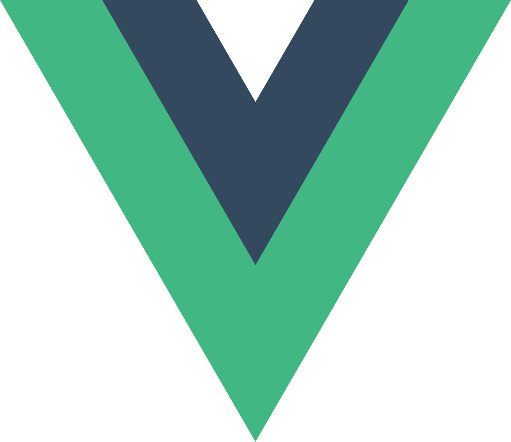

## Hey 👋, I'm Kaung Myat Paing!

Hi, I’m a web developer 🌐 currently diving deep into AI. My goal is to combine the power of modern web technologies with artificial intelligence to engineer creative solutions for everyday challenges.

 
 

  
### 🧐 More About Me:

- 🔭 &nbsp; I'm expanding my technical depth through a Master in **IT**
- 🌱 &nbsp; I’m currently learning python; 
<!-- - 👨🏻‍💻 &nbsp; Most of my projects are available on [Github](https://github.com/rahul-jha98?tab=repositories) -->
- 📫 &nbsp; Feel free to ping me on [LinkedIn](https://www.linkedin.com/in/kmpeg/)
- 📝 &nbsp; Checkout my [resume](https://drive.google.com/file/d/16Uc-ev2RifvWsQ05OzDImCnI3Msmg28g/view?usp=drive_link)

 

### 🔨 Languages and Tools:

<!--  

### 🛠️ My Projects
 -->